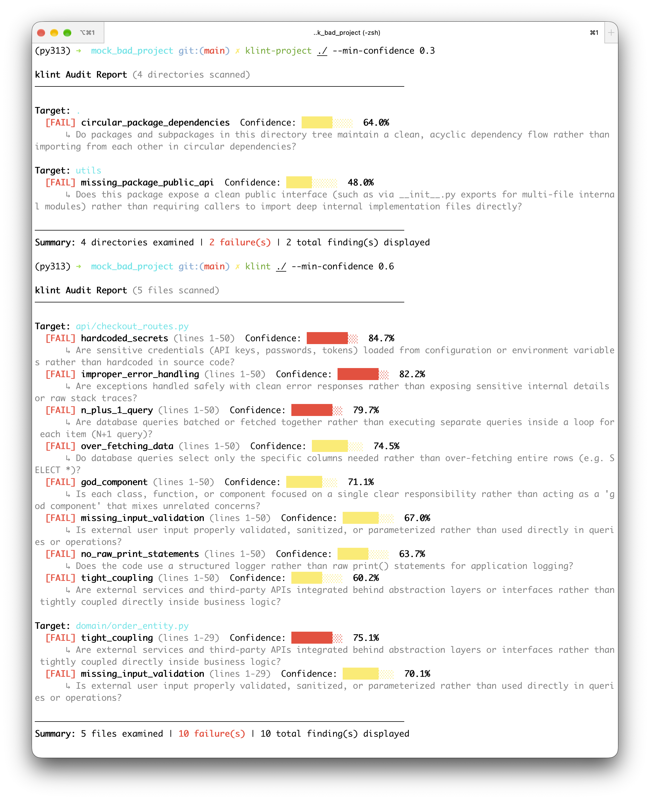

# klint
> **Semantic code auditing at the speed of Ruff, with the depth of an LLM—at zero token-generation cost.**

`klint` bridges the gap between rigid, syntax-bound linters (like ESLint or Ruff) and slow, expensive LLM code reviewers (like PR bots streaming tokens for 40 seconds). 
By leveraging the **System One (`/v1/systemone`)** pointer-head specification, `klint` evaluates files, package trees and an AI agent's summaries of its own change against custom JSON rule packs in a **single forward pass with zero decoded tokens**.

## Why klint?

* **Single-Pass, Zero-Generation Inference**: Evaluates an entire 16-rule pack in a single forward pass (~0.5s–2.5s per file locally on Apple Silicon MPS, or sub-second on CUDA / hosted `/v1/systemone`) rather than streaming hundreds of verbose reasoning tokens for 30+ seconds.
* **100% Local (`kev`) or Remote (`jev` / `kev.serve`)**: Run entirely offline on your machine using open-weight models (`kev-0.8b`, `kev-4b`) via Hugging Face, or point to any remote `/v1/systemone` endpoint (`jev` API or self-hosted `kev.serve`).
* **Declarative Plain-English Rules (`klint.json`)**: Define team-specific architectural rules or antipatterns using simple ESLint-style JSON configuration files—no complex AST or Semgrep DSL required.
* **Extensible by Suites**: Each suite brings its own unit types, extractors, renderers and rule packs, so teams can adapt `klint` to another language or another kind of audit without changing its core.

### How klint Compares (Related Work)

| Tool Category                      | Examples                                             | Speed & Cost                                     | Privacy                                  | Architectural & Semantic Depth                                                                                                                                                        |
| :--------------------------------- | :--------------------------------------------------- | :----------------------------------------------- | :--------------------------------------- | :------------------------------------------------------------------------------------------------------------------------------------------------------------------------------------ |
| **Deterministic Linters**          | ESLint, Ruff, Pylint, Semgrep                        | Instant, free                                    | 100% Local                               | **Syntax-bound**: Great for formatting and known AST patterns, but cannot judge domain cohesion, layering intent, or responsibility boundaries without brittle custom DSLs.           |
| **Generative LLM Reviewers**       | CodeRabbit, GPT/Claude PR Bots                       | Slow (20–45s/file), high token cost              | Cloud API (typically)                    | **High, but noisy**: Understands semantics, but relies on slow, non-deterministic autoregressive token generation.                                                                    |
| **Other System One (`jev`) Tools** | `ErisLint`, `jgrep`, `patdown`, `jev-pref`           | Fast (single forward pass)                       | Mostly Hosted `jev` API                  | **Flat file/diff scope**: Evaluates individual code chunks or diffs against rules, but lacks recursive package-tree modeling and native in-process `kev` execution.                   |
| **`klint`**                        | `klint`, `klint-structure`, `klint-change-summary`   | **Fast (single forward pass, 0 decoded tokens)** | **100% Local (`kev`) or Remote (`jev`)** | **File + Recursive Package Architecture**: Combines semantic code linting with composite Python AST directory trees, dependency rollups, and checks of an agent's change summaries.   |

## Features

* **File & Recursive Directory Auditing (`klint`)**: Scan individual source files or entire directory trees concurrently with live progress reporting and built-in concurrency throttling.
* **Recursive Python Project Structure Auditing (`klint-structure`)**: Audit Python package and directory hierarchies layer-by-layer, combining AST-based file metadata extraction (`imports`, `exports`, `classes`, `functions`, `line_count`, `__init__.py` public API status) with recursive subpackage dependency rollups and mutual cycle detection.
* **Change-Summary Checks (`klint-change-summary`)**: Check an AI agent's summary of its own change at every level: each hunk against its code, then each file, package and the commit against the checked summaries below it. False, unsupported or missing statements are flagged, false ones first.
* **4-Way Semantic Judgment & Confidence Sorting**: Classifies rules into `Pass`, `Fail`, `Irrelevant`, or `Lack of Evidence`, automatically sorting findings from highest confidence to lowest and supporting `--min-confidence` filtering.
* **Built-In Backend, React & Architectural Rule Packs** (in `klint/resources/catalog/`):
  * **File rules**: `backend.json` (N+1 queries, hardcoded secrets, sync blocking I/O, missing input validation, tight coupling, and more, for back-end code in any language), `react.json` (prop drilling, improper state colocation, direct DOM manipulation, overusing `useEffect`, missing hook dependency arrays, for TypeScript and JavaScript) and `file_design.json` (god components).
  * **Structure rules (`package_structure.json`)**: Circular package dependencies, layering violations, god packages, junk-drawer modules, barrel-file sprawl, leaky abstractions, missing package public APIs, and business logic in presentation layers.
  * **Change-summary checks (`summary_checks.json`)**: Accuracy (no false statement, no unsupported reason, no contradiction with the level below) and completeness.

## Installation & Quickstart

### Prerequisites
* Python 3.11 or later. The local judge, `kev`, runs on Python 3.12 or 3.13.

### Install
~~~bash
git clone https://github.com/skydiving94/klint.git
cd klint
pip install -e ".[local]"
~~~
The `local` extra installs `kev`, which runs the judge model on your machine. To ask only a remote judge (a `kev.serve` server or Jev), `pip install -e .` is enough.

### Quickstart
The default judge is `jaredpalmer/kev-4b`, run on your machine; the first run downloads it from Hugging Face.
~~~bash
# Audit a file or a directory against the file rules
klint examples/backend_data_and_security.py

# Audit a Python project's structure
klint-structure examples/mock_bad_project/

# Check an agent's summaries of a change
klint-change-summary examples/change_summary/summaries.json
~~~

## Commands

| Command | What it audits | Argument |
| :--- | :--- | :--- |
| `klint` | The contents of each file, against the file rules. | A file or a directory. |
| `klint-structure` | The structure of a project: each directory and Python package, from an outline of each file (imports, exports, classes, functions, line count). | A directory. |
| `klint-change-summary` | An agent's summaries of a change: each hunk against its code, and each file, package and the commit against the checked summaries below it. | A change-summary JSON document; see [examples/change_summary/README.md](examples/change_summary/README.md). |

Every command takes these options:

| Option | What it does |
| :--- | :--- |
| `--rules PATH` | Adds the rules in a JSON file. They merge over the built-in rules; a rule with the same ID replaces the built-in one. |
| `--min-confidence N` | Reports only the failures with at least this confidence, from 0.0 to 1.0 (default 0.0). |
| `--all-answers` | Shows every answer, not only the problems. |
| `--json` | Prints JSON instead of the terminal report. |

For example:
~~~bash
klint examples/ --min-confidence 0.65
klint examples/ --all-answers
klint examples/ --json
klint-structure examples/mock_bad_project/ --min-confidence 0.25 --json
~~~

### What a command prints
* **The judge**: a line on stderr, before the audit, names the judge the command asks, for example `[klint] Judge: jaredpalmer/kev-4b, run in this process (local)`.
* **The report**: findings are grouped by unit and sorted by confidence. Each unit with a problem is marked `OWN PROBLEM`, or `DESCENDANT PROBLEM` when the problem is in a unit nested inside it.
* **JSON**: with `--json`, stdout holds one object: the audited units (`examined_files`, `examined_directories` or `examined_summaries`), `unit_id_to_roll_up_status`, and `findings`. Each finding gives its `rule_id`, `unit_id`, `answer`, `confidence`, `question`, `tags` and `location` (`path`, `start_line`, `end_line`).

### Exit codes
| Code | Meaning |
| :--- | :--- |
| `0` | No failure was found at the confidence `--min-confidence` asks for. |
| `1` | At least one failure was found at that confidence. |
| `2` | The audit could not run: for example, the target or a rules file cannot be used, the judge cannot be reached for any unit, or an unexpected error occurred. |

~~~bash
klint examples/; echo "exit=$?"
klint no/such/path; echo "exit=$?"
~~~

## Configuration & Custom Rules (`klint.json`)

Like ESLint, `klint` works out of the box from any directory and discovers a **`klint.json`** (or **`.klintrc.json`**, or **`.klintrc`**) file: first in the target's directory (the file's directory when the target is a file), then in the working directory. You can also pass rules explicitly with `--rules ./custom_rules.json`; a `--rules` file holds rules only.

### Settings
Each setting is taken from the first of these that sets it: an environment variable, the `"env"` block of the project's `klint.json`, the built-in default.

| Setting | What it sets | Default |
| :--- | :--- | :--- |
| `KLINT_JUDGE_MODE` | `local` runs the model in the `klint` process; `remote` asks a `/v1/systemone` server. | `local` |
| `KLINT_JUDGE_MODEL` | The model: a Hugging Face repo ID or a local path when local; the server's model name when remote (for example `jev-latest`). | `jaredpalmer/kev-4b` |
| `KLINT_JUDGE_BASE_URL` | The server's address, when remote. | `http://127.0.0.1:8009` |
| `KLINT_JUDGE_API_KEY` | The API key the server asks for, when remote. Set it in your shell, never in `klint.json`. | none |
| `KLINT_REPLACE_FILE_RULES` | A rules file that replaces every built-in rule pack for `klint`. | none |
| `KLINT_REPLACE_PROJECT_RULES` | A rules file that replaces every built-in rule pack for `klint-structure`. | none |

A relative path set in `klint.json` is taken from the folder of the `klint.json`.

### What a `klint.json` holds
* `"env"`: settings, from the table above.
* `"rules"`: rules that merge over the built-in ones; a rule with the same ID replaces the built-in one. Rules may also sit at the top level of the file.
* `"fallback_rule_packs"`: the rule packs asked about a file whose language `klint` cannot identify, in place of the built-in `backend.json` and `file_design.json`.
* `"file_traits"`: corrections to the language or tags `klint` detects for some files, for example `[{"glob": "web/**", "tags": ["frontend"]}]`. The first entry whose glob matches a file decides.

~~~json
{
  "env": {
    "KLINT_JUDGE_MODE": "local",
    "KLINT_JUDGE_MODEL": "jaredpalmer/kev-4b"
  },
  "rules": {
    "no_raw_print_statements": {
      "type": "choice",
      "question": "Does the code use a structured logger rather than raw print() statements for application logging?",
      "unit_types": ["file"]
    },
    "domain_purity": {
      "type": "choice",
      "question": "Does the core domain package remain free of database ORM and HTTP framework imports rather than coupling domain entities to infrastructure?",
      "unit_types": ["project_directory"]
    }
  }
}
~~~

### Writing a rule
Because `klint` evaluates whether code **follows** a practice (`Pass`) or **violates** it (`Fail`), always phrase the `"question"` as a positive practice: **`"<positive practice> rather than <antipattern>?"`**.

| Field | What it holds |
| :--- | :--- |
| `type` | `"choice"`. |
| `question` | The question the judge answers about each unit. |
| `unit_types` | The units the rule is asked about: `file` (`klint`); `project_directory` and `file_metadata`, a file's outline (`klint-structure`); `hunk_summary`, `file_summary` and `package_summary` (`klint-change-summary`). Default `["file"]`. |
| `languages` | Limits the rule to files of these languages, for example `["python"]`. |
| `unit_tags` | Limits the rule to files with one of these tags, `backend` or `frontend`. A file with no detected tag is asked every rule. |
| `tags` | Labels for what the rule is about, such as `"security"`. |

## Judges

### Local (the default)
`KLINT_JUDGE_MODE=local` loads the model into the `klint` process; it needs the `local` extra. For a faster start on each run, use `KLINT_JUDGE_MODEL=jaredpalmer/kev-0.8b`, or keep a `kev.serve` server running.

### A `kev.serve` server
Start a server with the `kev` that the `local` extra installed, and leave it running:
~~~bash
python -m kev.serve --run jaredpalmer/kev-4b --port 8009
~~~
Then, in another shell:
~~~bash
KLINT_JUDGE_MODE=remote klint examples/
~~~

### Using Jev (TypeSafe's Hosted API)
`klint` can ask TypeSafe's hosted Jev model instead of a local `kev`, with no GPU and nothing else to install. You need a TypeSafe API key; see [docs.typesafe.ai](https://docs.typesafe.ai).

Set the key in your shell, not in `klint.json`, which is usually committed:
~~~bash
read -rs KLINT_JUDGE_API_KEY && export KLINT_JUDGE_API_KEY
export KLINT_JUDGE_MODE=remote KLINT_JUDGE_BASE_URL=https://api.typesafe.ai KLINT_JUDGE_MODEL=jev-latest
klint examples/
~~~

* **What leaves your machine**: the code of each audited unit (for `klint-change-summary`, each summary and its code) and the rule questions are sent to TypeSafe. Use the local `kev` for code that must stay on your machine.
* **Which judge**: each command's first line names the judge it asks, for example `[klint] Judge: jev-latest at https://api.typesafe.ai (remote, API key set)`. `klint` reads `KLINT_JUDGE_API_KEY`, not the `TYPESAFE_API_KEY` that TypeSafe's SDK reads.
* **A refused key**: `klint` skips each unit with "did not accept the API key" (or "needs an API key, and none was given") and exits with code 2 when no unit could be audited.

## GitHub Action

The repository is also a GitHub Action that runs `klint` or `klint-structure` in a workflow:

~~~yaml
jobs:
  klint:
    runs-on: ubuntu-latest
    steps:
      - uses: actions/checkout@v4
      - name: Audit with klint
        uses: skydiving94/klint@main
        with:
          target: "mypackage/"
          mode: "file"                      # "file" (klint) or "structure" (klint-structure)
          min_confidence: "0.65"
          judge_mode: "remote"
          judge_model: "jev-latest"
          judge_base_url: "https://api.typesafe.ai"
          judge_api_key: ${{ secrets.KLINT_JUDGE_API_KEY }}
~~~

| Input | Default | What it does |
| :--- | :--- | :--- |
| `target` | `.` | The file or directory to audit. |
| `mode` | `file` | `file` runs `klint`; `structure` runs `klint-structure`. |
| `min_confidence` | `0.60` | The least confidence a failure needs to be reported and to count as a problem. |
| `rules` | none | A rules file whose rules merge over the built-in ones. |
| `judge_mode` | `local` | Sets `KLINT_JUDGE_MODE`. `local` runs `kev` on the runner's CPU. |
| `judge_model` | `jaredpalmer/kev-0.8b` | Sets `KLINT_JUDGE_MODEL`. |
| `judge_base_url` | `http://127.0.0.1:8009` | Sets `KLINT_JUDGE_BASE_URL`. |
| `judge_api_key` | none | Sets `KLINT_JUDGE_API_KEY`. Pass it from a secret. |
| `fail_on_problems` | `true` | `true` fails the step when `klint` finds problems (exit 1); `false` reports them and passes. A run that cannot audit (exit 2) fails the step either way. |

* **Output**: `exit_code`, the command's exit code.
* **Job summary**: each run adds its report to the job summary.
* **Settings**: the Action always sets the judge's mode, model and address, so a `klint.json` `"env"` block does not choose the judge in the Action.

## Renamed in This Release

These names changed. Each old name still works until the next release and prints a warning naming its replacement.

| Old name | New name |
| :--- | :--- |
| `klint-project` | `klint-structure` |
| `--all` | `--all-answers` |
| `KEV_MODE`, `KEV_MODEL_NAME`, `KEV_BASE_URL`, `KEV_API_KEY` | `KLINT_JUDGE_MODE`, `KLINT_JUDGE_MODEL`, `KLINT_JUDGE_BASE_URL`, `KLINT_JUDGE_API_KEY` |
| `KEV_DEFAULT_RULES_PATH`, `KEV_DEFAULT_PROJECT_RULES_PATH` | `KLINT_REPLACE_FILE_RULES`, `KLINT_REPLACE_PROJECT_RULES` |
| Rule fields `instructions`, `target_unit_types` | `question`, `unit_types` |
| Action inputs `kev_mode`, `kev_model_name`, `kev_base_url`, `kev_api_key` | `judge_mode`, `judge_model`, `judge_base_url`, `judge_api_key` |
| Action input `mode: "project"` | `mode: "structure"` |

The source moved from `src/` to the `klint/` package, with no alias for code that imports it.

## Extending klint

`klint` is built from suites: the code suite (`klint`, `klint-structure`), the change-summary suite (`klint-change-summary`), and a domain-neutral suite they share. A suite adds its unit types, the extractors that read them, the renderers that write what the judge reads, and its rule packs. See [CONTRIBUTING.md](.github/CONTRIBUTING.md) for the layout and for how to add a rule pack, a language or a suite.

## Current Limitations (v0.1) & Performance Tips

* **Raw-Text File Audit (`klint`) vs. Python-Only Structure Audit (`klint-structure`)**:
  * `klint` (`WholeFileExtractor`) reads raw source text without an AST parser, so it evaluates any text-based source file (the built-in packs ship with rules for back-end code and for **React/TypeScript**; other languages can be targeted via custom rules in `klint.json`).
  * `klint-structure` (`PythonFileMetadataExtractor`) relies on Python's `ast` module to extract `imports`, `exports`, `classes`, and `functions`, so deep structural extraction currently supports **Python (`.py`)** files only (other files fall back to file names and line counts until multi-language AST extractors land).
* **Whole-File Context Window (`klint`)**: Because `klint` currently passes entire files as a single unit (`lines 1-N`) and small System One models (`kev-0.8b`, `kev-4b`) achieve peak accuracy on compact contexts (`<512` tokens), large files (`>300–500` lines) can experience lower confidence scores until AST component slicing (Roadmap #1) is enabled.
* **Eliminating Local CLI Cold-Start (`KLINT_JUDGE_MODE=local` vs. `kev.serve`)**: In `KLINT_JUDGE_MODE=local`, `klint` loads the open-weight checkpoint into memory once per CLI invocation (~3–5s startup for `kev-4b` on Apple Silicon). For instant startup across frequent runs, either use `jaredpalmer/kev-0.8b` or keep a persistent `kev.serve` process running in the background with `KLINT_JUDGE_MODE=remote`.
* **Directory Summary Confidence Calibration**: Because `klint-structure` evaluates compact AST metadata summaries rather than full source code bodies, `[FAIL]` confidence scores on directory rules are naturally more conservative (`20%–50%`) than file-level code rules (`70%–99%`).

## Roadmap & Upcoming Features

1. **Recursive Code Component Analysis & Context-Window Slicing**: Extracting granular AST units (`AuditablePythonClassUnit`, `AuditablePythonFunctionUnit`) so every unit stays inside `kev`'s high-accuracy `<512` token sweet spot while reporting exact method-level line numbers.
2. **Git Diff Mode (`--diff`)**: Sub-second pre-commit and PR auditing targeting only modified files and diff hunks.
3. **Claude Code Hooks & MCP Server Integration**: Exposing `klint` as a deterministic agent supervision hook and local MCP server so AI coding assistants (Claude Code, Cursor, Codex) can audit code in real time.
4. **Multi-Language AST Metadata Extractors**: Extending `BaseFileMetadataExtractor` to support TypeScript/JavaScript (`.ts`, `.tsx`) and Go for `klint-structure`.
5. **Inline GitHub PR Review Annotations**: Extending the GitHub Action with inline pull-request review comments on flagged line ranges.
6. **Permutation Calibration & Multi-Unit Batching**: Supporting `/v1/systemone/permute` debiasing on borderline findings and batching multiple small units per inference pass.
7. **Multi Media Auditing**: Supporting parsing and analyzing text files, latex etc. as writing assistant.

## Contributing

Contributions of all kinds—new language extractors, community rule packs, performance optimizations, or CI/editor integrations—are warmly welcomed! See [CONTRIBUTING.md](.github/CONTRIBUTING.md) for the setup, the layout, the checks and how pull requests merge.

## License

Distributed under the Apache License 2.0. See `LICENSE` for more information.
