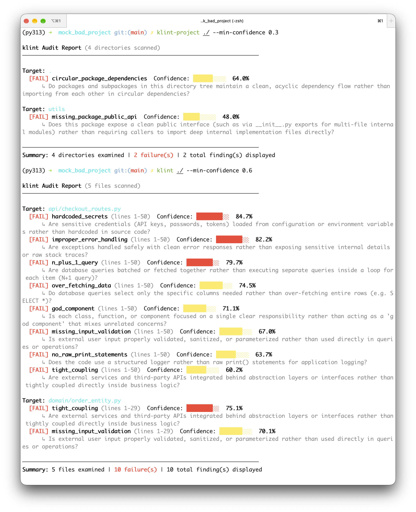

# klint
> **Semantic code auditing at the speed of Ruff, with the depth of an LLM—at zero token-generation cost.**

`klint` bridges the gap between rigid, syntax-bound linters (like ESLint or Ruff) and slow, expensive LLM code reviewers (like PR bots streaming tokens for 40 seconds). 
By leveraging the **System One (`/v1/systemone`)** pointer-head specification, `klint` evaluates files, package trees and an AI agent's summaries of its own change against custom JSON rule packs in a **single forward pass with zero decoded tokens**.

## Why klint?

* **Single-Pass, Zero-Generation Inference**: Evaluates an entire 16-rule pack in a single forward pass (~0.5s–2.5s per file locally on Apple Silicon MPS, or sub-second on CUDA / hosted `/v1/systemone`) rather than streaming hundreds of verbose reasoning tokens for 30+ seconds.
* **100% Local (`kev`) or Remote (`jev` / `kev.serve`)**: Run entirely offline on your machine using open-weight models (`kev-0.8b`, `kev-4b`) via Hugging Face, or point to any remote `/v1/systemone` endpoint (`jev` API or self-hosted `kev.serve`).
* **Declarative Plain-English Rules (`klint.json`)**: Define team-specific architectural rules or antipatterns using simple ESLint-style JSON configuration files—no complex AST or Semgrep DSL required.
* **Extensible by Suites**: Each suite brings its own unit types, extractors, renderers and rule packs, so teams can adapt `klint` to another language or another kind of audit without changing its core.

### How klint Compares (Related Work)

| Tool Category                      | Examples                                             | Speed & Cost                                     | Privacy                                  | Architectural & Semantic Depth                                                                                                                                                        |
| :--------------------------------- | :--------------------------------------------------- | :----------------------------------------------- | :--------------------------------------- | :------------------------------------------------------------------------------------------------------------------------------------------------------------------------------------ |
| **Deterministic Linters**          | ESLint, Ruff, Pylint, Semgrep                        | Instant, free                                    | 100% Local                               | **Syntax-bound**: Great for formatting and known AST patterns, but cannot judge domain cohesion, layering intent, or responsibility boundaries without brittle custom DSLs.           |
| **Generative LLM Reviewers**       | CodeRabbit, GPT/Claude PR Bots                       | Slow (20–45s/file), high token cost              | Cloud API (typically)                    | **High, but noisy**: Understands semantics, but relies on slow, non-deterministic autoregressive token generation.                                                                    |
| **Other System One (`jev`) Tools** | `ErisLint`, `jgrep`, `patdown`, `jev-pref`           | Fast (single forward pass)                       | Mostly Hosted `jev` API                  | **Flat file/diff scope**: Evaluates individual code chunks or diffs against rules, but lacks recursive package-tree modeling and native in-process `kev` execution.                   |
| **`klint`**                        | `klint`, `klint-structure`, `klint-change-summary`   | **Fast (single forward pass, 0 decoded tokens)** | **100% Local (`kev`) or Remote (`jev`)** | **File + Recursive Package Architecture**: Combines semantic code linting with composite Python AST directory trees, dependency rollups, and checks of an agent's change summaries.   |

## Features

* **File & Recursive Directory Auditing (`klint`)**: Scan individual source files or entire directory trees concurrently with live progress reporting and built-in concurrency throttling.
* **Recursive Python Project Structure Auditing (`klint-structure`)**: Audit Python package and directory hierarchies layer-by-layer, combining AST-based file metadata extraction (`imports`, `exports`, `classes`, `functions`, `line_count`, `__init__.py` public API status) with recursive subpackage dependency rollups and mutual cycle detection.
* **Change-Summary Checks (`klint-change-summary`)**: Check an AI agent's summary of its own change at every level: each hunk against its code, then each file, package and the commit against the checked summaries below it. False, unsupported or missing statements are flagged, false ones first.
* **[Python Classes & Functions as Units](#python-classes-and-functions)**: `klint` also judges each class and function of a Python file on its own, so a rule reads a short piece of code and a finding points to the exact method, with its lines.
* **[Change Summaries Read from Git](#change-summary-documents)**: An agent writes only its summaries, and `klint-change-summary` reads the change itself from git: a commit, or the uncommitted change.
* **[Claude Code Stop Hook](#claude-code-stop-hook)**: `klint-change-summary-stop-hook` keeps a Claude Code agent from stopping until its summaries of everything it changed in the session, committed or not, pass, and sends it back to fix the ones flagged.
* **[Staged-Change Audits (`klint --diff`)](#auditing-the-staged-change---diff)**: Audit only the units the staged change touches: each changed file, and the functions and classes on its changed lines.
* **[Pre-Commit Gate and Acknowledgement Log](#pre-commit-gate)**: `klint-pre-commit` blocks a commit while a finding in the staged change is neither fixed nor acknowledged. `klint-ack` records why a finding is wrong in `.klint/acknowledgements/`, which is committed and reviewed with the code.
* **[MCP Server (`klint-mcp`)](#mcp-server-klint-mcp)**: Offers every audit, and the rules, to a coding agent as MCP tools over stdio, so it can check its work when it wants to.
* **[Answer Cache](#the-answer-cache)**: On by default. The judge is never asked twice about the same code, rule and model, so a second run on an unchanged project sends no request.
* **[Judge Usage Report](#what-a-command-prints)**: Every command ends by saying how many requests and input tokens it sent to the judge, and how many questions the answer cache answered.
* **[Local Kev or Hosted Jev](#judges)**: Run the judge on your machine, on a `kev.serve` server, or ask TypeSafe's hosted Jev with an API key. Each command's first line names the judge it asks, and each judge is shown as much of a unit as it stays accurate on ([character budgets](#choosing-a-judge-and-a-threshold)).
* **[Project Layers for Structure Checks](#what-a-klintjson-holds)**: List a project's layers in `klint.json`, and `klint-structure` judges layering and leaking libraries against them. Its structure rules state their limits, such as the 15 modules a flat package may hold.
* **4-Way Semantic Judgment & Confidence Sorting**: Classifies rules into `Pass`, `Fail`, `Irrelevant`, or `Lack of Evidence`, automatically sorting findings from highest confidence to lowest and supporting `--min-confidence` filtering.
* **Built-In Backend, React & Architectural Rule Packs** (in `klint/resources/catalog/`):
  * **File rules**: `backend.json` (N+1 queries, hardcoded secrets, sync blocking I/O, missing input validation, tight coupling, and more, for back-end code in any language), `react.json` (prop drilling, improper state colocation, direct DOM manipulation, overusing `useEffect`, missing hook dependency arrays, for TypeScript and JavaScript) and `file_design.json` (god components).
  * **Structure rules (`package_structure.json`)**: Circular package dependencies, layering violations, god packages, junk-drawer modules, barrel-file sprawl, leaky abstractions, missing package public APIs, and business logic in presentation layers.
  * **Change-summary checks (`summary_checks.json`)**: Accuracy (no false statement, no unsupported reason, no contradiction with the level below), completeness, and a summary for every hunk, file and commit (`has_summary`, answered by `klint` itself).

## Installation & Quickstart

### Prerequisites
* Python 3.11 or later. The local judge, `kev`, runs on Python 3.12 or 3.13.

### Install
~~~bash
git clone https://github.com/skydiving94/klint.git
cd klint
pip install -e ".[local]"
~~~
The `local` extra installs `kev`, which runs the judge model on your machine. To ask only a remote judge (a `kev.serve` server or Jev), `pip install -e .` is enough.

### Quickstart
The default judge is `jaredpalmer/kev-4b`, run on your machine; the first run downloads it from Hugging Face.
~~~bash
# Audit a file or a directory against the file rules
klint examples/backend_data_and_security.py

# Audit a Python project's structure
klint-structure examples/mock_bad_project/

# Check an agent's summaries of a change
klint-change-summary examples/change_summary/summaries.json

# The same summaries alone, with the change read from git (commit d35fa76)
klint-change-summary examples/change_summary/summaries_only.json
~~~

## Commands

| Command | What it audits | Argument |
| :--- | :--- | :--- |
| `klint` | The contents of each file, and of each class and function in a Python file, against the file rules. | A file or a directory; or, with `--diff`, none: the staged change. |
| `klint-structure` | The structure of a project: each directory and Python package, from an outline of each file (imports, exports, classes, functions, line count). | A directory. |
| `klint-change-summary` | An agent's summaries of a change: each hunk against its code, and each file, package and the commit against the checked summaries below it. | A change-summary JSON document: summaries with each hunk's code, or summaries alone; see [Change-summary documents](#change-summary-documents). |
| `klint-change-summary-stop-hook` | Run by Claude Code at the start of a session and before its agent stops: the agent's summaries, in `.klint/change-summary.json`, of everything changed since the session started, committed or not; see [Claude Code Stop Hook](#claude-code-stop-hook). | None: it reads the hook event on stdin. It takes only `--min-confidence`. |
| `klint-pre-commit` | Run by git before a commit: the staged change, as `klint --diff` audits it, blocking the commit while a finding is neither fixed nor acknowledged; see [Pre-commit gate](#pre-commit-gate). | None. It takes `--min-confidence` and `--diff-units`. |
| `klint-ack` | Acknowledges a finding of `klint-pre-commit` as wrong, in `.klint/acknowledgements/`. | The entry's ID, which `klint-pre-commit` prints, and `--note "<why it is wrong>"`. |
| `klint-mcp` | Every audit above, and the rules, as MCP tools for a coding agent, over stdio; see [MCP Server](#mcp-server-klint-mcp). | None: the agent's client starts it. |

The first three commands take these options:

| Option | What it does |
| :--- | :--- |
| `--rules PATH` | Adds the rules in a JSON file. They merge over the built-in rules; a rule with the same ID replaces the built-in one. |
| `--min-confidence N` | Reports only the failures with at least this confidence, from 0.0 to 1.0 (default 0.0). |
| `--all-answers` | Shows every answer, not only the problems. |
| `--json` | Prints JSON instead of the terminal report. |
| `--diff` | `klint` only: audits the staged change of the current directory's repository instead of a path; see [Auditing the staged change](#auditing-the-staged-change---diff). |
| `--diff-units units\|file\|all` | With `--diff`: which units of each changed file are judged. `units` (the default) is the file and every function and class on a changed line, `file` the file alone, `all` every unit. |

For example:
~~~bash
klint examples/ --min-confidence 0.65
klint examples/ --all-answers
klint examples/ --json
klint-structure examples/mock_bad_project/ --min-confidence 0.25 --json
~~~

### Auditing the staged change (`--diff`)
`klint --diff` audits only what the staged change touches, for a quick check before a commit. It takes no path: the repository is that of the current directory, and the change is the index against `HEAD`, as `git diff --cached` shows it.

~~~bash
git add -A
klint --diff --min-confidence 0.5
klint --diff --diff-units all --json
~~~

* **The units**: `--diff-units` chooses which units of each changed file are judged. `units` (the default) takes the file unit, plus every function and class whose lines overlap a changed line, so a changed method brings its class along. `file` takes the file units only; `all` takes every unit of the changed files. A new file counts as changed on every line, a deleted file is skipped and a renamed file is audited under its new path. A file in a language klint does not cut into units, such as Go, gets its file unit.
* **What it says**: the report is a full audit's, limited to those units, and a line on stderr counts them, for example `[klint] Staged change: 2 files, 3 of 9 units selected (--diff-units units); 1 deleted file skipped`. With `--json`, a `staged_change` object adds the `files`, the `deleted_files`, the `unit_count` and `selected_unit_count`, and the `selected_units` with each one's `unit_id`, `unit_type`, `location` and `context`. Unit IDs are relative to the current directory, as for a path given on the command line.
* **Nothing staged**: `[klint] No staged change to audit`, exit 0. Outside a git repository: exit 2.
* **With the answer cache**, a unit whose code has not changed costs no request, so a second `klint --diff` on the same change is free.
* **Unstaged edits**: the changed lines come from the index, and the code of each unit from the working tree. When a staged file also has unstaged edits, klint says so with a warning; stage the whole file for an exact result.

#### Any diff (`--diff-from`)
`klint --diff-from <file>` audits what a unified diff in git's format touches, read from a file, or from stdin with `-`. Any such diff works, so a pull request's change is one pipe away:

~~~bash
git diff main...HEAD | klint --diff-from -
gh pr diff 123 | klint --diff-from - --diff-units file
~~~

* **The same audit**: `--diff-units`, the units chosen and the report are those of `--diff`. On stderr the count reads `[klint] Change in the diff: …`, and with `--json` the same fields come under `diff_change`. `--diff` itself is the staged change, `git diff --cached`, put through the same reading.
* **The files are read from disk**: the diff's paths are taken as relative to the current directory, so run it where the diff was made, usually the repository's top. Where the diff has `index <old>..<new>` lines, each changed file must hash to `<new>`, as `git hash-object` hashes it; a file that doesn't, or is missing, stops the run with exit 2, naming it. Check out the diff's head first, as a pull request's CI does. A diff with no `index` lines is taken as it is, with a warning.
* **What it reads**: diffs with or without lines of context, with the `a/` and `b/` prefixes, others such as `--no-prefix`, quoted paths and paths with spaces. A combined diff of a merge, a diff in another format such as `diff -u`'s, and a file outside the current directory are refused with exit 2; a diff that can't be read names its line.
* **An empty diff**: `[klint] No change in the diff to audit`, exit 0.

### Change-summary documents
`klint-change-summary` takes a JSON document in one of two forms. Both hold a summary for each hunk, each file, each package you choose to summarize, and the whole commit.

| Form | What it holds | Where the code comes from |
| :--- | :--- | :--- |
| With the code | `diff_command`, and a nested `root_package` whose hunks hold their removed and added lines. | The document. |
| Summaries only | `git_change`, the commit's `summary`, and flat `packages` and `files` lists. | git, in the repository of the current directory. |

A summaries-only document, abridged from [examples/change_summary/summaries_only.json](examples/change_summary/summaries_only.json):
~~~json
{
  "schema_version": 1,
  "git_change": {"commit": "d35fa76"},
  "summary": "Lists a binary file by name only in the project audit, and adds tests for it.",
  "packages": [
    {"path": "tests", "summary": "Adds two tests that a binary file is listed by name only."}
  ],
  "files": [
    {
      "path": "src/catalog/code/common/extractors/traits_based_extraction_delegator.py",
      "summary": "Lists a likely binary file by name only.",
      "hunks": [
        {"header": "@@ -20,0 +21 @@", "summary": "Imports is_likely_binary."}
      ]
    }
  ]
}
~~~
* **The change**: `git_change.commit` names a commit as git does (`HEAD`, a hash), which is checked against its first parent. With no `commit`, as in `"git_change": {}`, the change is the uncommitted one against `HEAD`: staged and unstaged edits and untracked files, not ignored ones. The document's own file is never part of the change.
* **The hunks**: each hunk is named by its header as `git diff -U0` writes it, for example in the output of `git diff -U0 HEAD` or `git show -U0 <commit>`. Text after the closing `@@` is ignored. An untracked file is one hunk, `@@ -0,0 +1,N @@`. A binary file, or a rename without edits, has no hunk: summarize it at the file level. A renamed file is listed by its new path. In the report, a hunk is `<path>#<n>`, numbered from 1 in its file.
* **The packages**: optional directories you summarize. Each file and package sits in the deepest listed package that holds it, else directly in the commit.
* **A missing summary**: a hunk or file of the change, a listed package or the commit with no summary fails `has_summary` (exit 1). `klint` answers that check itself, with no confidence (and no `location` for a summary the document does not list), and answers "Cannot Tell" for the summary just above it, since the judge would read an incomplete premise there.
* **A summary that does not fit the change** stops the command (exit 2): a hunk, file or package the change does not hold, or a header that is not a hunk header. So do an unknown commit, a directory outside any git repository, and an empty change.

See [examples/change_summary/README.md](examples/change_summary/README.md) for both forms of one real change.

### What a command prints
* **The judge**: a line on stderr, before the audit, names the judge the command asks, for example `[klint] Judge: jaredpalmer/kev-4b, run in this process (local); answer cache at /Users/me/Library/Caches/klint/answers`. The answer cache's folder follows when the cache is on.
* **The judge's usage**: two lines on stderr, after the report. `[klint] Answer cache: 120 questions answered from the cache, 30 asked` says what the answer cache did; `[klint] Judge usage: 12 requests, 15,432 input tokens` counts what was sent to the judge. A request answered from the cache alone counts no request and no tokens. With `--json`, the same counts are under `answer_cache` and `judge_usage`.
* **The report**: findings are grouped by unit and sorted by confidence. Each unit with a problem is marked `OWN PROBLEM`, or `DESCENDANT PROBLEM` when the problem is in a unit nested inside it.
* **JSON**: with `--json`, stdout holds one object: the audited units (`examined_files`, `examined_directories` or `examined_summaries`), `unit_id_to_roll_up_status`, and `findings`. Each finding gives its `rule_id`, `unit_id`, `answer`, `confidence`, `question`, `tags`, `location` (`path`, `start_line`, `end_line`) and `context` (for a Python class or function, its `qualified_name`).

### Exit codes
| Code | Meaning |
| :--- | :--- |
| `0` | No failure was found at the confidence `--min-confidence` asks for. |
| `1` | At least one failure was found at that confidence. |
| `2` | The audit could not run: for example, the target or a rules file cannot be used, the judge cannot be reached for any unit, or an unexpected error occurred. |

~~~bash
klint examples/; echo "exit=$?"
klint no/such/path; echo "exit=$?"
~~~

## Configuration & Custom Rules (`klint.json`)

Like ESLint, `klint` works out of the box from any directory and discovers a **`klint.json`** (or **`.klintrc.json`**, or **`.klintrc`**) file: first in the target's directory (the file's directory when the target is a file), then in the working directory. You can also pass rules explicitly with `--rules ./custom_rules.json`; a `--rules` file holds rules only.

### Settings
Each setting is taken from the first of these that sets it: an environment variable, the `"env"` block of the project's `klint.json`, the built-in default.

| Setting | What it sets | Default |
| :--- | :--- | :--- |
| `KLINT_JUDGE_MODE` | `local` runs the model in the `klint` process; `remote` asks a `/v1/systemone` server. | `local` |
| `KLINT_JUDGE_MODEL` | The model: a Hugging Face repo ID or a local path when local; the server's model name when remote (for example `jev-latest`). | `jaredpalmer/kev-4b` |
| `KLINT_JUDGE_BASE_URL` | The server's address, when remote. | `http://127.0.0.1:8009` |
| `KLINT_JUDGE_API_KEY` | The API key the server asks for, when remote. Set it in your shell, never in `klint.json`. | none |
| `KLINT_REPLACE_FILE_RULES` | A rules file that replaces every built-in rule pack for `klint`. | none |
| `KLINT_REPLACE_PROJECT_RULES` | A rules file that replaces every built-in rule pack for `klint-structure`. | none |
| `KLINT_ANSWER_CACHE` | Where the judge's answers are kept between runs (see [The answer cache](#the-answer-cache)), or `off` to keep none. | the user's cache folder |

A relative path set in `klint.json` is taken from the folder of the `klint.json`.

### What a `klint.json` holds
* `"env"`: settings, from the table above.
* `"rules"`: rules that merge over the built-in ones; a rule with the same ID replaces the built-in one. Rules may also sit at the top level of the file.
* `"fallback_rule_packs"`: the rule packs asked about a file whose language `klint` cannot identify, in place of the built-in `backend.json` and `file_design.json`.
* `"file_traits"`: corrections to the language or tags `klint` detects for some files, for example `[{"glob": "web/**", "tags": ["frontend"]}]`. The first entry whose glob matches a file decides.
* `"layers"`: the project's layers, outermost first, for example `["myapp.cli", "myapp.services", "myapp.core"]`. `klint-structure` shows them to the judge when it asks `layering_violation` and `leaky_abstraction`, and takes the last as the core. Without them, both rules ask about layers in general terms.
* `"rule_exclusions"`: rules the project turns off for some of its paths, for example `[{"rule_id": "god_component", "paths": ["legacy/**"], "reason": "Being replaced by the new module"}]`. Each entry holds exactly a `rule_id`, `paths`, globs matched from the folder of the `klint.json` (a class or function by its file's path), and a `reason`. The rule is not asked about a matching unit, and every other rule still is. The report lists each exclusion it applied, and `--json` adds them as `applied_rule_exclusions` when there are some, with the IDs of the units each covered.
  * **Unit selectors**: a `paths` entry may name a class or function by its unit ID, as klint prints it, such as `"klint/app/settings.py::AppSettings"` or `"cart.py::Cart.total"`. It covers that unit and every unit nested in it, so a class's selector covers its methods, but not the file unit. Globs work in both parts: `"klint/app/*.py::*Settings"`; in the name, `*` stops at a `.` and `**` crosses it. The terminal report lists the units a selector covered. A renamed class stops matching, so its finding comes back.
  * **Stale entries**: when a full audit of a folder that holds an entry's path finds no unit for it to turn its rule off for, klint warns once, naming the entry. A diff audit, the commit gate included, doesn't warn, since it sees only part of the project; nor does an audit whose rules don't include the entry's rule.

~~~json
{
  "env": {
    "KLINT_JUDGE_MODE": "local",
    "KLINT_JUDGE_MODEL": "jaredpalmer/kev-4b"
  },
  "rules": {
    "no_raw_print_statements": {
      "type": "choice",
      "question": "Does the code use a structured logger rather than raw print() statements for application logging?",
      "unit_types": ["file"]
    },
    "domain_purity": {
      "type": "choice",
      "question": "Does the core domain package remain free of database ORM and HTTP framework imports rather than coupling domain entities to infrastructure?",
      "unit_types": ["project_directory"]
    }
  }
}
~~~

### Writing a rule
Because `klint` evaluates whether code **follows** a practice (`Pass`) or **violates** it (`Fail`), always phrase the `"question"` as a positive practice: **`"<positive practice> rather than <antipattern>?"`**.

| Field | What it holds |
| :--- | :--- |
| `type` | `"choice"`. |
| `question` | The question the judge answers about each unit. |
| `question_with_layers` | The question asked instead, when the project's `klint.json` lists its `layers`; `{layers}` marks where they go, joined by commas. |
| `unit_type_to_question` | The question asked instead about a unit of each type named, for example `{"file_summary": "..."}`. A type the rule is not asked about is warned about. |
| `unit_types` | The units the rule is asked about: `file`, and `class` and `function` in a Python file (`klint`); `project_directory` and `file_metadata`, a file's outline (`klint-structure`); `hunk_summary`, `file_summary` and `package_summary` (`klint-change-summary`). Default `["file"]`. |
| `languages` | Limits the rule to files of these languages, for example `["python"]`. |
| `unit_tags` | Limits the rule to files with one of these tags, `backend` or `frontend`. A file with no detected tag is asked every rule. |
| `excluded_unit_tags` | Keeps the rule from units with one of these tags. `klint-structure` tags a Python package `data` when its tree holds no module but `__init__.py`, as a folder of data files does; the built-in `dead_code_module` and `missing_package_public_api` are not asked about it. |
| `tags` | Labels for what the rule is about, such as `"security"`. |

### Python classes and functions
`klint` reads a Python file as a `file` unit and, nested in it, a unit for each class and function. A rule for them is then asked about a short piece of code instead of the whole file, and its findings point to the exact method.

| Unit type | What it is | What the judge reads |
| :--- | :--- | :--- |
| `class` | Each class at the top of a file, and each class defined in a class. | The class with each method's body replaced by `...`: its decorators, bases, docstring, class-level statements and method signatures stay. |
| `function` | Each function at the top of a file, and each method, async or not. A function defined inside a function, such as a decorator's wrapper, is part of the outer function. | The function's source, decorators included. |

* A class or function defined inside an `if`, `try`, `with` or loop statement counts as defined where that statement is.
* **IDs and lines**: a unit's ID is its file's path and its qualified name, as in `shop/cart.py::Cart.add`. When two units share a qualified name, as a property and its setter do, each ID ends with its first line, as in `shop/cart.py::Cart.total:14`. A finding gives the unit's lines in `location` and its qualified name in `context`.
* **Roll-up**: a method sits under its class and a class under its file. A problem in a method marks its class and its file `DESCENDANT PROBLEM`.
* **Long units**: a class or function over the judge's character budget (see [Choosing a judge and a threshold](#choosing-a-judge-and-a-threshold)) is shown from its first line, as far as the budget goes, as a long file is. A finding on it says it was cut, and gives `cut_at_characters` in JSON.
* **Unparseable files**: a Python file that cannot be parsed is still judged whole, with a warning, and its classes and functions are not judged on their own.

For Python, the built-in rules about one function are asked about each class or function instead of the whole file (`python/functions_and_classes.json`):
* `function`: `n_plus_1_query`, `improper_error_handling`, `sync_blocking_io`, `missing_input_validation` and `over_fetching_data`.
* `class` and `function`: `god_component`.
* `hardcoded_secrets` and `tight_coupling` stay on the whole file, where a module's constants and imports are.

For every other language, the built-in rules are still asked about the whole file.

~~~json
{
  "short_functions": {
    "type": "choice",
    "question": "Is each function short enough to read at a glance rather than running through many unrelated steps?",
    "unit_types": ["function"]
  }
}
~~~

## Judges

### Local (the default)
`KLINT_JUDGE_MODE=local` loads the model into the `klint` process; it needs the `local` extra. For a faster start on each run, use `KLINT_JUDGE_MODEL=jaredpalmer/kev-0.8b`, or keep a `kev.serve` server running.

### A `kev.serve` server
Start a server with the `kev` that the `local` extra installed, and leave it running:
~~~bash
python -m kev.serve --run jaredpalmer/kev-4b --port 8009
~~~
Then, in another shell:
~~~bash
KLINT_JUDGE_MODE=remote klint examples/
~~~

### Using Jev (TypeSafe's Hosted API)
`klint` can ask TypeSafe's hosted Jev model instead of a local `kev`, with no GPU and nothing else to install. You need a TypeSafe API key; see [docs.typesafe.ai](https://docs.typesafe.ai).

Set the key in your shell, not in `klint.json`, which is usually committed:
~~~bash
read -rs KLINT_JUDGE_API_KEY && export KLINT_JUDGE_API_KEY
export KLINT_JUDGE_MODE=remote KLINT_JUDGE_BASE_URL=https://api.typesafe.ai KLINT_JUDGE_MODEL=jev-latest
klint examples/
~~~

* **What leaves your machine**: the code of each audited unit (for `klint-change-summary`, each summary and its code) and the rule questions are sent to TypeSafe. Use the local `kev` for code that must stay on your machine.
* **Which judge**: each command's first line names the judge it asks, for example `[klint] Judge: jev-latest at https://api.typesafe.ai (remote, API key set)`. `klint` reads `KLINT_JUDGE_API_KEY`, not the `TYPESAFE_API_KEY` that TypeSafe's SDK reads.
* **A refused key**: `klint` skips each unit with "did not accept the API key" (or "needs an API key, and none was given") and exits with code 2 when no unit could be audited.

### The answer cache
Every judge is asked only about what it has not answered before. Each answer is kept, keyed by the model's version, the text the judge read and the question with its criteria, so a unit whose code has not changed is never asked about twice, and a change to the code, to a rule's wording or to the model asks again. The cache holds answers only: no code, no question text, no API key.

* **Where**: `~/Library/Caches/klint/answers` on macOS, `$XDG_CACHE_HOME/klint/answers` (by default `~/.cache/klint/answers`) on Linux, `%LOCALAPPDATA%\klint\answers` on Windows. `KLINT_ANSWER_CACHE=/another/folder` moves it; a relative path in `klint.json` is taken from the folder of the `klint.json`.
* **Off**: `KLINT_ANSWER_CACHE=off`.
* **The model's version**: resolved once per run from the server's `/v1/models`, so an alias such as `jev-latest` that moves to a new release starts afresh. A name the server does not list, such as `jev-1.14.0`, is taken as a version in itself. When the server cannot be reached, the run asks everything and says so with a warning. A local checkpoint given as a folder has no version, so it is never cached.
* **Entries** record the klint version and when they were written. A corrupt entry is asked again, with a warning. Delete the folder to start over.
* **Repeatability**: a cached run reproduces the run that filled the cache. Jev's answers are not always the same from one run to the next on long structure units at low confidence; see the measurements on [#91](https://github.com/skydiving94/klint/issues/91).

### Choosing a judge and a threshold
The defaults stay as they are: the local `jaredpalmer/kev-4b`, and `--min-confidence 0.0`. What each judge is shown, and the threshold to use with it:

| Judge | Characters of a file, class or function | Threshold for code (the commit gate's default) | Threshold for change summaries |
| :--- | ---: | ---: | ---: |
| `jev-latest` (hosted) | 60,000 (measured up to 12,000) | `0.8` | `0.6` |
| `jaredpalmer/kev-9b` (local, about 22 GB) | 8,000 | `0.5` | `0.5` |
| `jaredpalmer/kev-4b` (local, the default) | 2,000 | `0.5` | `0.5` |
| Any other model | 2,000 | `0.8` | not measured |

* **The character budgets** come from a code-unit test set of 371 true units and 229 planted problems, from under 1,000 to 12,000 characters (`judge_accuracy/code_units/`): each judge is shown as much as it stays accurate on. Kev-4B catches too few problems for a longer text to help. Jev is accurate up to 12,000, the longest the set holds; past that it is not yet measured, and 60,000 stays within the 32,000 tokens it accepts per request. A finding on a unit that was cut says so. A change summary's hunk is shown up to 4,000 characters, with every judge, and the structure audit keeps 2,000.
* **Jev for code at `0.8`**: below it, Jev flags long true functions as `god_component`, at confidences from 0.36 to 0.79. The commit gate's default threshold follows the judge in use; `KLINT_COMMIT_MIN_CONFIDENCE` sets a project's own (see [Pre-commit gate](#pre-commit-gate)).

For `klint-change-summary`, a test set of 141 labelled summaries from 6 commits of this repository (78 true, 63 with a planted mistake, 16 of them omissions) gave:

| Judge | Mistakes caught (0.0) | Omissions caught (0.0) | True summaries flagged (0.0) | Caught / flagged at the recommended threshold |
| :--- | ---: | ---: | ---: | :--- |
| `jev-latest` (hosted) | 60/63 | 13/16 | 12/78 | 55 / 3 at `0.6` |
| `jaredpalmer/kev-9b` (local, about 22 GB) | 38/63 | 0/16 | 1/78 | 32 / 0 at `0.5` |
| `jaredpalmer/kev-4b` (local, the default) | 39/63 | 0/16 | 4/78 | 27 / 0 at `0.5` |

* **With an API key**: Jev at `--min-confidence 0.6`. It is the only judge here that catches omissions. Most of its false flags are on file summaries.
* **Without one, or for code that must stay on your machine**: the default Kev-4B at `--min-confidence 0.5`. It flags no true summary, but catches fewer than half the mistakes and no omissions. Kev-9B catches a few more.
* The sets are small and labelled by one person, so a difference of two or three cases is noise, and Jev's results vary by two to four true summaries flagged from one run to the next. To score a judge yourself, see [CONTRIBUTING.md](.github/CONTRIBUTING.md#scoring-a-judge).

## GitHub Action

The repository is also a GitHub Action that runs `klint` or `klint-structure` in a workflow:

~~~yaml
jobs:
  klint:
    runs-on: ubuntu-latest
    steps:
      - uses: actions/checkout@v4
      - name: Audit with klint
        uses: skydiving94/klint@main
        with:
          target: "mypackage/"
          mode: "file"                      # "file" (klint) or "structure" (klint-structure)
          min_confidence: "0.65"
          judge_mode: "remote"
          judge_model: "jev-latest"
          judge_base_url: "https://api.typesafe.ai"
          judge_api_key: ${{ secrets.KLINT_JUDGE_API_KEY }}
~~~

| Input | Default | What it does |
| :--- | :--- | :--- |
| `target` | `.` | The file or directory to audit. |
| `mode` | `file` | `file` runs `klint`; `structure` runs `klint-structure`. |
| `min_confidence` | `0.60` | The least confidence a failure needs to be reported and to count as a problem. |
| `rules` | none | A rules file whose rules merge over the built-in ones. |
| `judge_mode` | `local` | Sets `KLINT_JUDGE_MODE`. `local` runs `kev` on the runner's CPU. |
| `judge_model` | `jaredpalmer/kev-0.8b` | Sets `KLINT_JUDGE_MODEL`. |
| `judge_base_url` | `http://127.0.0.1:8009` | Sets `KLINT_JUDGE_BASE_URL`. |
| `judge_api_key` | none | Sets `KLINT_JUDGE_API_KEY`. Pass it from a secret. |
| `fail_on_problems` | `true` | `true` fails the step when `klint` finds problems (exit 1); `false` reports them and passes. A run that cannot audit (exit 2) fails the step either way. |

* **Output**: `exit_code`, the command's exit code.
* **Job summary**: each run adds its report to the job summary.
* **Settings**: the Action always sets the judge's mode, model and address, so a `klint.json` `"env"` block does not choose the judge in the Action.

## Claude Code Stop Hook

`klint-change-summary-stop-hook` keeps a Claude Code agent from stopping until `klint-change-summary` passes its summaries of its change: everything it changed in the session, committed or not. Each time the agent is about to stop, the hook checks the summaries in `.klint/change-summary.json`. When they are missing, it asks the agent to write them, with instructions and the list of changed files and hunks. A flagged summary sends the agent back to fix it.

### Setting it up
1. **Install klint** (see [Install](#install)) so that `klint-change-summary-stop-hook` is on the `PATH` Claude Code starts with. Otherwise, give the command's full path in step 3, such as `/path/to/klint/.venv/bin/klint-change-summary-stop-hook`.
2. **Choose the judge** for the project, as for any `klint` command (see [Judges](#judges)): in the environment Claude Code starts with, or in an `"env"` block of a `klint.json` at the project's root. For a `kev.serve` server on the default port:
   ~~~json
   {"env": {"KLINT_JUDGE_MODE": "remote"}}
   ~~~
   Keep a Jev API key in the shell's environment, not in `klint.json`.
3. **Turn the hook on** in the project's `.claude/settings.json`, for both events:
   ~~~json
   {
     "hooks": {
       "SessionStart": [
         {"hooks": [{"type": "command", "command": "klint-change-summary-stop-hook"}]}
       ],
       "Stop": [
         {"hooks": [{"type": "command", "command": "klint-change-summary-stop-hook", "timeout": 300}]}
       ]
     }
   }
   ~~~
   At `SessionStart`, the hook records the commit the session starts at; at each `Stop`, it checks everything changed since, the commits the agent made included. Without the `SessionStart` entry, it checks the uncommitted change alone. Checking takes a few seconds a summary, so a large change may need a longer `timeout`. To block only on failures with at least some confidence, add an option to the `Stop` command, such as `klint-change-summary-stop-hook --min-confidence 0.5`.
4. **Commit** `.claude/settings.json` and any `klint.json` you added, or they are part of the change the agent is asked to summarize.

### What the hook does
| When the agent is about to stop | The hook |
| :--- | :--- |
| Nothing changed since the session's start commit, or, without one, the working tree has no change | Lets it stop. |
| There is no `.klint/change-summary.json`, or it does not name exactly the change's files and hunks | Blocks: asks for summaries of the current change, listing the files and hunks to summarize. |
| Every summary passes | Lets it stop. |
| `klint` flags summaries | Blocks, listing each flagged summary and the checks it failed. |
| The summaries file cannot be read, such as a JSON error or a field of the wrong kind | Blocks with `klint`'s error. |
| `klint` cannot check the summaries for another reason, such as the judge being down | Lets it stop, with a warning to you. |
| The hook has blocked 3 times in a row in this session | Lets it stop, with a warning to you and what it said last. |
| The session's start commit is no longer in the branch's history, after a rebase, an amend or a branch switch | Checks the uncommitted change alone, with a warning to you. |

* **The change**: from the commit recorded at the session's start to the working tree, as for `"git_change": {"base": "<commit>"}`: the commits made since, staged and unstaged edits, and untracked files, not ignored ones. The hook's messages name the exact `git_change` to write. Without a recorded start commit, it is the uncommitted change against `HEAD`, as for `"git_change": {}`. Commits made before the session are never checked.
* **The hook's own files**: the summaries go in `.klint/`, which the hook marks ignored with a `.klint/.gitignore`, so they are never part of the change, nor committed. The start commit and the blocks in a row are kept per session in the repository's git directory, outside the working tree; two sessions in one project each keep their own.
* **Blocks in a row**: the count starts again whenever the agent may stop, and at a stop that does not follow a Stop hook's block, such as the first after your next prompt.
* **Trying it by hand**: from the project, feed the hook a SessionStart event, make and commit a change, then feed it a Stop event:
  ~~~bash
  echo '{"session_id": "try-1", "cwd": "'"$PWD"'", "hook_event_name": "SessionStart", "source": "startup"}' | klint-change-summary-stop-hook
  echo '{"session_id": "try-1", "cwd": "'"$PWD"'", "hook_event_name": "Stop", "stop_hook_active": false}' | klint-change-summary-stop-hook
  ~~~
  The Stop prints a `"decision": "block"` with its reason, a `systemMessage` warning, or nothing when the agent may stop; the SessionStart prints nothing. Both always exit 0.

## MCP Server (`klint-mcp`)

`klint-mcp` offers every klint audit to one coding agent as MCP tools, over stdio. The agent runs an audit when it wants to, and reads the findings as `--json` prints them, with the judge's usage. The server expects the judge to be running already and never starts one.

### Setting it up in a Claude Code project
1. **Install klint** (see [Install](#install)) so that `klint-mcp` is on the `PATH` Claude Code starts with. Otherwise, give the command's full path in step 3, such as `/path/to/klint/.venv/bin/klint-mcp`.
2. **Choose a served judge** for the project, as for any `klint` command (see [Judges](#judges)), in a `klint.json` at the project's root. For a `kev.serve` server on the default port:
   ~~~json
   {"env": {"KLINT_JUDGE_MODE": "remote"}}
   ~~~
   Keep a Jev API key in the shell's environment, not in `klint.json`. The server refuses the local mode, which would load the model in its own process on every call.
3. **Add the server** to the project, from its root:
   ~~~bash
   claude mcp add --scope project klint -- klint-mcp
   ~~~
   This writes a `.mcp.json` at the project's root that Claude Code reads when it starts there; commit it. To add the server for every project instead, use `--scope user`.
4. **Start Claude Code** in the project, approve the project's `klint` server when it asks (until then, `claude mcp list` shows it as pending approval), and check `/mcp` lists `klint` as connected. The agent then calls the tools as it needs them, such as "audit the staged change with klint", and each call shows in the session.

The server audits paths inside the directory Claude Code started it in, the project's root, and refuses any other.

### The tools
| Tool | Arguments | What it returns |
| :--- | :--- | :--- |
| `audit_files` | `path`, or `diff` (true) with `diff_units` (`units`, `file`, `all`); `min_confidence`, `all_answers`, `rules_path` | What `klint --json` prints: `examined_files`, `unit_id_to_roll_up_status`, `findings`, `judge_usage`, and `staged_change` with `diff`. |
| `audit_structure` | `path`; `min_confidence`, `all_answers`, `rules_path` | What `klint-structure --json` prints. |
| `check_change_summary` | `path` of a change-summary document; `min_confidence`, `all_answers`, `rules_path` | What `klint-change-summary --json` prints. |
| `list_rules` | `path`; `rules_path` | Each rule an audit of the path would ask, with the units it would be asked about, and the project's exclusions that applied. No judge is asked. |
| `explain_rule` | `rule_id` | Each pack that defines the rule: its question, unit types, and the languages and unit tags it is limited to. |

A long audit sends progress notifications, one per unit audited. When the judge cannot be reached, or the audit cannot run, the tool returns an error with the reason and the server keeps serving.

## Pre-commit gate

`klint-pre-commit` is a git pre-commit hook: it audits the staged change as `klint --diff` does and blocks the commit while a finding is neither fixed nor acknowledged. Findings and acknowledgements are kept in the repository, in `.klint/acknowledgements/`, one JSON file per entry, so that a false positive is recorded once and reviewed with the code.

### Setting it up
1. **Install klint** (see [Install](#install)) so that `klint-pre-commit` and `klint-ack` are on the `PATH`, and **choose the judge** as for any `klint` command (see [Judges](#judges)), for example with a `klint.json` at the project's root: `{"env": {"KLINT_JUDGE_MODE": "remote"}}` for a `kev.serve` server on the default port.
2. **Turn the hook on**, either way:
   * As a plain git hook:
     ~~~bash
     printf '#!/bin/sh\nexec klint-pre-commit\n' > .git/hooks/pre-commit && chmod +x .git/hooks/pre-commit
     ~~~
   * With the [pre-commit](https://pre-commit.com) framework, in `.pre-commit-config.yaml`, then `pre-commit install`:
     ~~~yaml
     repos:
       - repo: https://github.com/skydiving94/klint
         rev: main
         hooks:
           - id: klint-pre-commit
     ~~~
     The hook runs the `klint-pre-commit` on the `PATH`, so the framework installs nothing for it. The framework warns that `main` is a branch, which it does not update after the first install; `pre-commit autoupdate --bleeding-edge` pins it to `main`'s latest commit.
3. **Commit** the `klint.json` and, with the framework, `.pre-commit-config.yaml`.

### What the hook does
| When you commit | The hook |
| :--- | :--- |
| Nothing is staged, or no finding reaches the threshold | Lets the commit through. |
| A finding reaches the threshold | Blocks: lists each finding with its ID and the `klint-ack` command for it, logs it as `open` in `.klint/acknowledgements/` and stages the log. |
| A finding matches an `acknowledged` entry: same rule, file, unit and code | Lets the commit through, saying how many findings were acknowledged. |
| An open entry's finding is gone, because the code was fixed or the unit removed | Removes the entry and stages the removal. |
| The judge is down, klint cannot run, or an entry file cannot be read | Blocks, saying why. `git commit --no-verify` skips the check. |

* **Threshold**: a failure blocks from the confidence of the judge in use, 0.8 for Jev and 0.5 for Kev. `KLINT_COMMIT_MIN_CONFIDENCE`, in the environment or the `"env"` block of `klint.json`, sets the project's own; `klint-pre-commit --min-confidence 0.7` wins over both. `--diff-units` chooses the units as for [`--diff`](#auditing-the-staged-change---diff).
* **Acknowledging a finding that is wrong**: `klint-ack <id> --note "<why it is wrong>"`, with the ID the hook printed. The note is required and recorded. The entry is staged with the commit. The finding stays acknowledged while the unit's code hashes the same; once the code changes, the judge's finding on it is a new entry, and the old one stays as history.
* **The log**: each entry records the rule, the file, the unit's kind, name and lines, a hash of the unit's code, the finding and its confidence, the judge's model version, when it was first flagged, its status, and, once acknowledged, when and the note. klint writes it: the hook adds and removes entries for the staged change only, and `klint-ack` acknowledges. The same staged change and the same answers give the same entries, apart from the timestamps. Every `klint` audit of the repository leaves out the findings an acknowledged entry covers and lists them, as `applied_acknowledgements` in `--json`; a `rule_exclusions` entry in `klint.json` turns a rule off for some paths whatever the code, while an acknowledgement covers one finding on one version of the code.
* **A commit made with `--no-verify`** can leave open entries behind; the next gated commit that stages those files brings them up to date.

## Removed Names

The old names kept for one release after the renames are gone. Use each replacement:
* `klint-project`: `klint-structure`.
* `--all`: `--all-answers`. klint refuses `--all`.
* `KEV_MODE`, `KEV_MODEL_NAME`, `KEV_BASE_URL`, `KEV_API_KEY`: `KLINT_JUDGE_MODE`, `KLINT_JUDGE_MODEL`, `KLINT_JUDGE_BASE_URL`, `KLINT_JUDGE_API_KEY`.
* `KEV_DEFAULT_RULES_PATH`, `KEV_DEFAULT_PROJECT_RULES_PATH`: `KLINT_REPLACE_FILE_RULES`, `KLINT_REPLACE_PROJECT_RULES`.
* Rule fields `instructions`, `target_unit_types`: `question`, `unit_types`.
* Action inputs `kev_mode`, `kev_model_name`, `kev_base_url`, `kev_api_key`: `judge_mode`, `judge_model`, `judge_base_url`, `judge_api_key`.
* Action input `mode: "project"`: `mode: "structure"`. The Action fails on it.

klint ignores an old setting or rule field with a warning naming its replacement, and GitHub warns about an old Action input.

The source moved from `src/` to the `klint/` package, with no alias for code that imports it.

## Extending klint

`klint` is built from suites: the code suite (`klint`, `klint-structure`), the change-summary suite (`klint-change-summary`), and a domain-neutral suite they share. A suite adds its unit types, the extractors that read them, the renderers that write what the judge reads, and its rule packs. See [CONTRIBUTING.md](.github/CONTRIBUTING.md) for the layout and for how to add a rule pack, a language or a suite.

## Current Limitations (v0.1) & Performance Tips

* **Python Is the Only Language Parsed**:
  * `klint` reads any text-based source file. It also splits a **Python (`.py`)** file into its classes and functions; a file in any other language is judged whole (the built-in packs ship with rules for back-end code and for **React/TypeScript**; other languages can be targeted via custom rules in `klint.json`).
  * `klint-structure` relies on Python's `ast` module to extract `imports`, `exports`, `classes`, and `functions`, so deep structural extraction supports **Python** files only (other files fall back to file names and line counts until multi-language extractors land).
* **Long Units**: A file, class or function over the judge's character budget is shown only as far as the budget goes: 2,000 characters for Kev-4B, 8,000 for Kev-9B and 60,000 for Jev, whose accuracy past 12,000 is not yet measured (see [Choosing a judge and a threshold](#choosing-a-judge-and-a-threshold)). No judge sees a problem that sits past the cut, and a finding on a cut unit says so.
* **Few Rules for a Whole Python File**: the Python rules for one function replace the file-level rules of the same ID, so a Python file unit is asked only `hardcoded_secrets` and `tight_coupling`.
* **Change Summaries**:
  * A hunk over 4,000 characters is shown only in part, and no judge sees a mistake that sits past the cut.
  * The local Kevs catch no omission. Jev catches most, but misses a file summary that names every hunk and leaves out the file's main change, and flags some true file summaries on `covers_every_change` or `covers_key_changes`.
* **Staged Change Only**: `klint --diff` and the commit gate read the staged change; neither audits a range of commits, such as a pull request's, nor unstaged edits. `klint-structure` still audits the whole project.
* **One Local Agent over MCP**: `klint-mcp` serves one agent over stdio, on the machine it runs on, and needs a served judge: it refuses the local mode.
* **Eliminating Local CLI Cold-Start (`KLINT_JUDGE_MODE=local` vs. `kev.serve`)**: In `KLINT_JUDGE_MODE=local`, `klint` loads the open-weight checkpoint into memory once per CLI invocation (~3–5s startup for `kev-4b` on Apple Silicon). For instant startup across frequent runs, either use `jaredpalmer/kev-0.8b` or keep a persistent `kev.serve` process running in the background with `KLINT_JUDGE_MODE=remote`.
* **Directory Summary Confidence Calibration**: Because `klint-structure` evaluates compact AST metadata summaries rather than full source code bodies, `[FAIL]` confidence scores on directory rules are naturally more conservative (`20%–50%`) than file-level code rules (`70%–99%`).

## Roadmap & Upcoming Features

Shipped in this release:
* Commit-ready checks: `klint --diff` on the staged change, the pre-commit gate with its acknowledgement log, the `klint-mcp` server, the answer cache, the judge usage report, a character budget per judge, and a Stop hook that checks the agent's commits too.
* Agent-ready checks: Python class and function units, change summaries read from git, the Claude Code Stop hook, and the hosted Jev judge.

Upcoming:
1. **More of Git Diff Mode**: `--diff` against a ref, for pull requests, and against the working tree; and a `klint-structure` audit of the packages that changed only.
2. **MCP over HTTP**: `klint-mcp` for several clients and remote agents, and hooks for agents other than Claude Code.
3. **Multi-Language Extractors**: Class and function units, and `klint-structure` outlines, for TypeScript/JavaScript (`.ts`, `.tsx`) and Go.
4. **Inline GitHub PR Review Annotations**: Extending the GitHub Action with inline pull-request review comments on flagged line ranges.
5. **Permutation Calibration & Multi-Unit Batching**: Supporting `/v1/systemone/permute` debiasing on borderline findings, and packing several small units into one request.
6. **Non-Code Files**: Auditing text documents, LaTeX and other writing.
7. **More Accurate Local Judges**: A hosted Kev-27B and a Kev-4B fine-tuned on labelled change summaries, scored on the same test set.
8. **Removing the Old Names**: the names in [Removed Names](#removed-names) stop working.

## Contributing

Contributions of all kinds—new language extractors, community rule packs, performance optimizations, or CI/editor integrations—are warmly welcomed! See [CONTRIBUTING.md](.github/CONTRIBUTING.md) for the setup, the layout, the checks and how pull requests merge.

## License

Distributed under the Apache License 2.0. See `LICENSE` for more information.
